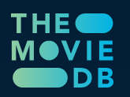

# MovieValut

## Introduction

`MovieValut` are a fictive name of a frontend application where users can browse movies and related information about the movie and actors, search, filter, sort, paginate and view movie details.

The frontend are developed with React/Vite/TypeScript with moder UI and responsiveness. The application are fetching the movie related data from The Movie Database API:
https://www.themoviedb.org

This project are part of an assigment in the course Web Development with React.  
https://www.iths.se/utbildningar/webbutveckling-med-react-2/


## Purpose and Goals

I did recently finish a course in Next.js and I wanted to learn more about specifics with just React and only frontend.
I wanted to repeat my old knowledge in development and React. Also to archive more advance skills in React.

I have put extra much time to document things with the purpose for the teacher to understand my thing and how I was working during this project.

But I also documented for myself so I learn more details about things and then I have my notes saved.
It is also for future jobs that I have something serious to show what I can.


## Table of Contents

- [Features](#features)
- [Usage](#usage)
- [Getting Started](#getting-started)
- [Architecture](#architecture)
- [Screenshots](#screenshots)
- [Environment Variables](#environment-variables)
- [Production URL](#production-url)
- [Other Documentations](#other-documentations)
  - [Design](#design)
  - [Assignment](#assignment)
  - [Deployment](#deployment)
  - [The Movie Database (TMDB)](#the-movie-database-tmdb)
- [Usage of AI](#usage-of-ai)
- [Author](#author)
- [Resources and Tools](#resources-and-tools)
- [TMDB Attribute Credits](#tmdb-attribute-credits)

More detailed documentations and Table of content can be found here:
https://github.com/the-hive-resistance/ykrea26h1-inlamningsuppgift-patrikiden-dev/blob/main/docs/START.md


## Features

- Browse movies.
- Search, filter, sort movies with Pagination. Or by categories Now Playing, Trending or Top Rated.
- View movie and actor details.
- The whole website is responsive and checked to the lowest width at 360px.
- The accessibility has been checked with WAVE (Web Accessibility Evaluation Tool) and Google Lighthouse.


## Usage

1. Open the application.
2. Browse, search, filter, or sort movies. Or by categories Now Playing, Trending or Top Rated.
3. Click on a movie to view its details.
4. Use Pagination bar to click though all movies.
5. Switch between light and dark mode.


## Getting Started

First, install the dependencies:

```bash
npm install

```

To start the development server, run:

```bash
npm run dev
```

Open your browser and go to `http://localhost:5173` to view the application.


## Architecture

- **Moviedex** is built with React.js using Vite and TypeScript.
- This application are using React Router, React Context and TanStack React Query.
- Other libs that are used are Axios, Zod, React Hooks Form and more.
- UI is made by Tailwind CSS, Shadcn/UI, Lucid Icons with Inter font.
- Light and Dark mode.
- Pagination, sort and filter movies.
- Movie details in subpage.
- Deployment on Netlify.

## Screenshots

Coming!

The only screenshots available just now are **Mockups** that are stored in `docs/screenshoots/` folder.  
Or you can also check the documentation for DESIGN here.  
https://github.com/the-hive-resistance/ykrea26h1-inlamningsuppgift-patrikiden-dev/blob/main/docs/DESIGN.md


## Environment Variables

Create a `.env` file in the root of the project and add the following environment variables:

```env
VITE_TMDB_BASE_URL=https://api.themoviedb.org/3
VITE_TMDB_IMAGE_URL=https://image.tmdb.org/t/p/w500
VITE_TMDB_READ_TOKEN=your_token_here
```

> Never commit your `.env` file or expose secret values.


## Production URL

To be change to real URL when website are deployed!  
https://www.netlify.com/


## Other Documentations

All other documentations for this web application are stored in `docs/` folder. All screenshoots and images 
user tougher with the documentation are stored in `docs/screeenshoots/` folder.


### Design

Information about my initial planing with UI, Mockups and Design. 
https://github.com/the-hive-resistance/ykrea26h1-inlamningsuppgift-patrikiden-dev/blob/main/docs/DESIGN.md


### Assignment

Information about the assignment for this web application.  
https://github.com/the-hive-resistance/ykrea26h1-inlamningsuppgift-patrikiden-dev/blob/main/docs/ASSIGNMENT.md


### Deployment

Information about the deployment on Netlify (optional) for this web application. But it is require to 
deploy the web application somewhere. Another option is to use GitHub Pages or Vercel.  
https://github.com/the-hive-resistance/ykrea26h1-inlamningsuppgift-patrikiden-dev/blob/main/docs/DEPLOYEMNT.md


### Testing

Information about the testing of this web application.  
https://github.com/the-hive-resistance/ykrea26h1-inlamningsuppgift-patrikiden-dev/blob/main/docs/TESTING.md


### The Move Database (TMDB)

Information about the TMDB (The Movie Database), the TMDB APIs and resources related to THDB.  
https://github.com/the-hive-resistance/ykrea26h1-inlamningsuppgift-patrikiden-dev/blob/main/docs/TMDB.md


## Usage of AI

I use AI as a sounding board, primarily to understand concepts, ideas, and problems that I don’t understand or 
haven’t found a solution for.
I also use it to occasionally generate images, or to help write documentation and get suggestions for code solutions.
AI has also been very helpful in teaching me various things when I’ve wanted lessons on a specific topic.


## Author

Patrik Idén  
patrikiden@yahoo.se  
https://github.com/patrikiden-dev  
https://www.linkedin.com/in/patrikiden/  


## Resources and Tools

- JetBrains WebStorm IDE (https://www.jetbrains.com/webstorm/)
- React.js (https://react.dev/)
- Vite (https://vite.dev)
- Tailwind (https://tailwindcss.com/)
- Shadcn/ui (https://ui.shadcn.com/)
- TypeScript (https://www.typescriptlang.org/)
- Lucid Icons (https://lucide.dev/)
- React Hook Form (https://react-hook-form.com/)
- Axios (https://axios-http.com/)
- Zod [Validation] (https://zod.dev/)- 
- React Router (https://reactrouter.com/)
- TanStack Query (https://tanstack.com/query/latest)
- TanStack Query DevTools (https://tanstack.com/query/latest/docs/react/devtools)
- React Developer Tools (https://react.dev/learn/react-developer-tools)
- WAVE (https://wave.webaim.org/)
- Google Lighthouse (https://developers.google.com/web/tools/lighthouse)
- Google Stitch [UI Design Tool] (https://stitch.google.com/)
- Postman [API Testing] (https://www.postman.com/)
- Vitest [Testing] (https://vitest.dev/)
- React Testing Library (https://testing-library.com/)
- Netlify [Deployment] (https://www.netlify.com/)
- RealFaviconGenerator (https://realfavicongenerator.net/)
- Adobe Photoshop (https://www.adobe.com/products/photoshop.html)
- JPG to WEBP Converter (https://www.online-convert.com/image/webp)
- @unpic/react [Image Optimazation] (https://unpic.pics/img/react/)
- Figma [UI Design Tool] (https://www.figma.com/)


##  TMDB Attribute Credits

This website uses TMDB (The Movie Database) and the TMDB APIs but is not endorsed, certified, or 
otherwise approved by TMDB.  
https://www.themoviedb.org/




